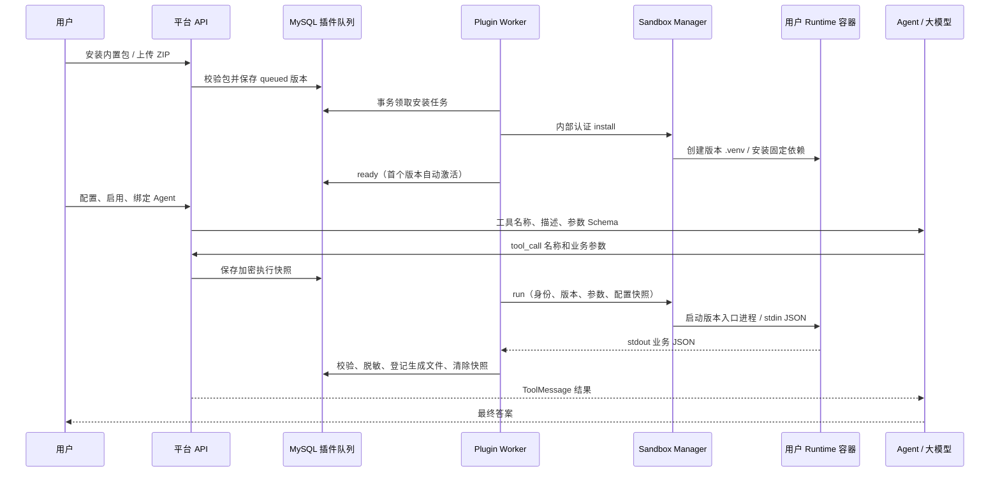

# 插件管理

## 实现方案（work_list）

1. 内置 BI、JSON 和上传插件统一使用标准 Python 进程包，声明身份、版本、配置、工具 Schema 和可选 Skill。
2. 为每个用户安装代码和版本独立依赖，复用该用户的 Runtime Docker 容器，网络按已确认的设置开放。
3. 安装、调试、连接测试与 Agent 调用通过插件 Worker / Sandbox Manager 执行，每次调用启动新进程。
4. 配置和密钥按用户保存，密钥加密；启用、绑定和调试必须已有 ready 安装版本。
5. 删除宿主 BI/JSON 执行器、全局环境工具和环境导入入口，不迁移或恢复旧插件专用配置。

本日实施记录见 [work_list/2026-10-21.md](../work_list/2026-10-21.md)。

## 首次使用

进入「插件管理」，两个平台提供的插件初始显示「未安装」。点击「安装」或「安装与版本 → 安装到 Runtime 容器」，等待「已就绪」。内置仅表示包来源，仍须为当前用户准备代码与依赖；配置记录不能代替安装。

- **JSON 格式处理**：安装后无需配置，直接启用；调试支持格式化、排序和压缩 JSON。Agent 工具名为 `plugin__json_tools__JsonFormat`。
- **BI 元数据查询**：安装后填写 BI 服务地址、Token，保存配置；输入产品标识进行连接测试，再启用。Agent 工具名为 `plugin__bi_metadata__BiCli`，附带包内 BI Skill。

启用后，在 Agent 编辑页「关联插件」选择并保存。后续对话、外部 API 和工作流按绑定加载工具。连接测试与调试直接执行容器工具，无需请求大模型。

BI 地址要使用**容器可达**的地址：Docker Desktop 访问宿主机服务通常使用 `host.docker.internal`，容器中的 `127.0.0.1` 指向容器自己。基础地址应包含 BI 实际 context path，例如 `/portal-api/bi-docker/api`。`bi-metadata@2.0.0` 已扩展为 SolarEngine BI 分析与 AB 测试：保留五类列表查询，新增完整接口目录、业务查询和受配置与平台权限控制的修改工具。配置、接口覆盖和使用说明见 [SolarEngine BI / Rule 插件](solarengine-bi-rule-plugin.md)。

草稿可保存未完成配置，启用和执行前校验必填项。保存后的密钥不回显，留空保留原值，勾选「清除」显式删除。配置变更重置连接状态；测试失败不会自动停用。停用保留 Agent 绑定，后续请求不再加载工具及配套 Skill。移除配置或卸载前先解除绑定。

## 代码职责

| 文件 | 职责 |
| --- | --- |
| `backend/plugins/{bi_metadata,json_tools}/` | 平台包源码、manifest、requirements.lock、入口与可选 Skill |
| `backend/plugins/packages.py` | 进程协议实体、ZIP/Schema/固定依赖校验及工具命名 |
| `backend/plugins/examples.py` / `registry.py` | 内置目录和确定性打包，不包含用户配置 |
| `backend/plugins/storage.py` | 用户私有版本存储、安装状态实体 |
| `backend/services/plugin_package_service.py` | 内置/上传安装、版本、执行和卸载 |
| `backend/services/plugin_service.py` | 通用配置、密钥、启停、检测、绑定及审计 |
| `backend/plugin_worker.py` | 领取 MySQL 持久化任务并调用 Sandbox |
| `sandbox_service/app.py` / `process_runner.py` | 共享容器、版本依赖、进程监督与输出限制 |
| `backend/core/plugin_tools.py` / `tools.py` | 已安装工具适配及包内 Skill 读取 |
| `frontend/src/views/plugins/PluginList.vue` | 安装状态、配置、调试、版本管理 |

业务服务使用 `PluginSettings`、`StoredPlugin`、`RuntimePlugins`、`InstalledPackage`、`PluginExecution`、`ProcessResult` 等实体；动态映射仅用于配置、Schema 和 JSON 协议边界。

## 安装与执行链

本次确认的方案是：插件 ZIP 携带代码和声明 → 平台校验并异步安装 → 在用户现有 Runtime Docker 容器中启动一次 Python 进程 → 将标准 JSON 结果交给 Agent。每次工具调用都启动新进程，依赖虚拟环境按插件版本复用。MCP 作为已有的另一种工具来源继续保留，此执行链不需要 MCP Server。



### 使用与部署

在项目根目录运行，下列进程使用相同的数据库、数据目录、加密主密钥和 Sandbox 内部 Token：

```bash
export SANDBOX_SERVICE_TOKEN="请替换为随机内部密钥"
export SANDBOX_SERVICE_URL="http://127.0.0.1:20002"
docker compose -f docker-compose.sandbox.yml up -d --build

# 分别在独立终端启动
python -m backend.plugin_worker
python -m backend.runtime_worker
python -m backend.main
```

PyCharm 运行配置选择「模块名称」`backend.plugin_worker`，工作目录为项目根目录，解释器使用 `backend/.venv-langchan/bin/python`。Runtime Worker 同样选择 `backend.runtime_worker`。部署后重启 API 和两个 Worker，并重建 Sandbox 镜像/服务。

内置插件点击「安装」即可。导出的是同一个标准包，保留 ID `json-tools` / `bi-metadata` 和 `builtin` 来源，用户也可以上传该原始包完成安装。内置 ID 只接受当前平台原始包；修改代码时改为自己的 ID，上传后的来源由平台设为 `upload`。包内不包含用户配置或密钥。等待「已就绪」后配置、启用并绑定 Agent。

安装状态为 `queued → installing → ready / failed`。重新上传内容相同、版本相同的失败包可以重试；同版本不同内容返回 409，必须增加版本号。新版本准备完成不会替换旧激活版本，用户在版本页手动切换；可以切回仍保留的旧版本。切换校验配置兼容性，已进入运行的任务继续使用原版本快照。卸载前解除 Agent 绑定并等待安装/执行任务结束。「移除配置」和「卸载安装包」分别管理用户配置与版本文件。

### 包目录与 manifest

ZIP 根目录包含声明、依赖清单和入口文件，不能多套一层文件夹：

```text
manifest.json
requirements.lock
executor/main.py
SKILL.md               # 可选，只包含描述和使用指引
references/usage.md    # 可选，必须列入 skill_files
```

一个最小 JSON 插件声明：

```json
{
  "id": "my-json",
  "name": "我的 JSON 插件",
  "version": "1.0.0",
  "description": "格式化 JSON 文本",
  "executor": "python-process",
  "protocol_version": 1,
  "entrypoint": "executor/main.py",
  "timeout_seconds": 30,
  "tools": ["Format"],
  "fields": [],
  "permissions": ["data.transform"],
  "capabilities": {"debug": true},
  "tool_definitions": [
    {
      "name": "Format",
      "description": "格式化用户提供的 JSON 文本",
      "parameters": {
        "type": "object",
        "properties": {"content": {"type": "string"}},
        "required": ["content"],
        "additionalProperties": false
      },
      "output_schema": {
        "type": "object",
        "properties": {"formatted": {"type": "string"}},
        "required": ["formatted"],
        "additionalProperties": false
      },
      "risk_level": "medium"
    }
  ]
}
```

`id` 为最长 60 字符的小写字母/数字/连字符，首字符必须为字母；`version` 为 `major.minor.patch`，可加预发布后缀。最多 30 个工具，原始名称以字母开头，只含字母、数字、下划线，最长 48 字符。模型公开工具名为 `plugin__my_json__Format`；超出 64 字符时平台添加稳定摘要缩短。输入 Schema 根为对象，支持数组、嵌套和文档内引用，拒绝远程引用。`output_schema` 校验成功结果的 `data`。

配置 `fields` 沿用通用字段模型，`secret` 字段按用户独立加密。进程包支持 debug 及可选的声明式 connection_test，不支持宿主环境导入。工具风险只能为 `medium` / `high`，沿用现有工具权限流水线；manifest 的 permissions 是能力声明，不代表系统调用级别的网络或文件隔离。

`requirements.lock` 必须存在，无依赖时为空。每行只允许 `包名==固定版本` 或注释，不能填写 URL、本地路径、pip 参数或版本范围。必须列出全部间接依赖；安装使用 `--only-binary=:all: --no-deps`，随后运行 `pip check`。不提供 wheel 的依赖或漏写间接依赖会安装失败。依赖目录为版本自己的 `.venv`，安装失败重试先清理半安装目录。上传最大 20MB，解压最大 80MB / 1000 条目，拒绝越界路径、重复路径、链接、特殊或加密文件。

### 连接检测声明

BI 的连接检测也使用已声明的工具。例如：

```json
{
  "capabilities": {"connection_test": true, "debug": true},
  "test_fields": [{"key": "product_key", "label": "产品标识", "kind": "string", "required": true}],
  "probe": {
    "tool_name": "BiCli",
    "arguments_template": {
      "arguments": ["metadata", "events", "list", "--product-key", "{{product_key}}", "--page-num", "1", "--page-size", "1"]
    }
  }
}
```

平台按 `test_fields` 校验用户输入，将完整 `{{字段名}}` 值替换为对应 JSON 值，再按目标工具 Schema 校验真实参数并进入同一执行队列。数字和布尔值保留原类型，普通字符串不会做部分插值。模板必须引用已声明的检测字段，不能携带密钥；凭据仍取当前插件配置。`connection_test` 与 `probe` 必须同时声明。

### 执行输入、配置与结果

入口从 stdin 读取一次请求，stdout 只输出一个 JSON 对象，不使用 JSON-RPC，也不与模型直接交互：

```json
{
  "protocol_version": 1,
  "execution_id": "a59f03dc649e4a69bfec9e6e0476e436",
  "tool_name": "Format",
  "arguments": {"content": "{\"b\":2,\"a\":1}"}
}
```

配置和凭据通过这次 Docker Exec 环境注入，入口按需要读取：

| 环境变量 | JSON/值的含义 |
| --- | --- |
| `PLUGIN_VALUES` | 普通配置对象，例如 `{"base_url":"https://example.test"}` |
| `PLUGIN_SECRETS` | 当前插件密钥对象，例如 `{"token":"仅示意"}` |
| `PLUGIN_INPUT_FILES` | 授权文件 ID 到容器内输入副本路径的映射 |
| `PLUGIN_OUTPUT_DIR` | 这次执行的输出目录 |

成功与业务失败的 stdout：

```json
{"ok":true,"data":{"formatted":"{\n  \"a\": 1,\n  \"b\": 2\n}"},"error":null}
```

```json
{"ok":false,"data":null,"error":{"code":"INVALID_JSON","message":"JSON 文本无效"}}
```

平台返回给 Agent 的结果还包含 `artifacts` 文件引用数组。入口不要提供下载地址；平台会扫描并登记输出文件。stdout/stderr 各上限 1MB，单次运行 1～120 秒，进程超时、取消、退出或输出超限后监督器清理进程组。stderr 不回传，临时 stdout/stderr、控制及输入 JSON 在收集后清理。输出非 JSON、不符合 Schema、包含 NaN 或缺少失败原因，任务标记失败；不会自动重试业务调用。

模型只收到工具定义及业务结果，Docker 路径、依赖、密钥和 Sandbox Token 由平台管理。例如一次模型交互的工具消息如下（模型厂商兼容格式）：

```json
[
  {"role":"user","content":"把 {\"b\":2,\"a\":1} 格式化并按键排序"},
  {"role":"assistant","content":null,"tool_calls":[
    {"id":"call_001","type":"function","function":{
      "name":"plugin__json_tools__JsonFormat",
      "arguments":"{\"content\":\"{\\\"b\\\":2,\\\"a\\\":1}\",\"sort_keys\":true}"
    }}
  ]},
  {"role":"tool","tool_call_id":"call_001","content":"{\"ok\":true,\"data\":{\"formatted\":\"{\\n  \\\"a\\\": 1,\\n  \\\"b\\\": 2\\n}\"},\"error\":null,\"artifacts\":[]}"},
  {"role":"assistant","content":"格式化结果：\n{\n  \"a\": 1,\n  \"b\": 2\n}"}
]
```

上面是协议示例；本次验收实际执行了工具工厂与 Docker 调用，没有请求真实模型。

### 文件与 Skill

需要文件输入时设置 `file_input_parameter`，例如 `"file_input_parameter":"file_ids"`，并在所有工具 Schema 中声明该字段为字符串数组。调用方传平台 `file_id`，平台检查用户所有权后复制输入；入口读取 `PLUGIN_INPUT_FILES` 获取路径。生成文件写入 `PLUGIN_OUTPUT_DIR`，平台登记到现有 `runtime_files`，返回带 `file_id/name/size/url` 的 `artifacts`，下载沿用登录认证。单次最多 100 个文件、总量受 `PYTHON_RUNTIME_MAX_OUTPUT_MB`（默认 20MB）约束，拒绝链接。

Skill 通过 `skill_name` 和 `skill_files` 声明，只允许包内白名单文件。内容中的 `{{tool:Format}}` 会替换为模型实际公开名称，避免手写命名空间。Skill 是说明文本，执行行为仍由入口代码和工具契约提供。

### 管理 API 与存储

原有配置、启停、调试和 Agent 绑定 API 同时适用于上传插件。新增接口：

| 接口 | 作用 |
| --- | --- |
| `POST /api/plugins/{id}/install` | 安装平台提供的内置包，复用上传队列和失败重试 |
| `POST /api/plugins/packages/upload` | multipart 字段 `file` 上传 ZIP |
| `GET /api/plugins/{id}/versions` | 当前用户的版本及安装状态 |
| `POST /api/plugins/{id}/versions/{version}/activate` | 切换 ready 版本 |
| `GET /api/plugins/{id}/export?version=1.0.0` | 导出安装原始包；未安装内置插件导出平台标准包 |
| `DELETE /api/plugins/{id}/package` | 无绑定、无进行中任务时卸载所有版本和配置 |
| `POST /api/plugins/executions/{execution_id}/cancel` | 取消当前用户的执行 |

新增 `plugin_packages` 和 `plugin_executions`，由启动迁移幂等创建，`backend/sql/init.sql` 同步提供新表。任务状态和加密请求直接保存在 MySQL，Worker 使用事务领取，省去数据库与第二条 Redis 队列的双写一致性问题。Runtime 继续沿用原有 Redis 队列。加密执行快照在终态清除，过期 running/installing 在 Worker 中标记失败；重启 Worker 不自动重复有副作用的调用。

版本目录：`backend/data/runtime/users/{user_id}/workspaces/plugins/{plugin_id}/{version}/`，包含 `package/`、原始 `package.zip`、`.venv/`、`.ready`。执行目录位于 `plugins/.executions/{execution_id}/`，输入副本与生成文件使用现有 Runtime 数据生命周期；卸载版本不会删除已经登记的生成文件。

### 容器与信任边界

用户明确选择 Runtime 和插件复用同一个 Docker 容器，并允许网络访问。Compose 设置 `SANDBOX_NETWORK_ENABLED=true`；Runtime 允许相应网络库，额外第三方依赖须自行提供，标准库 urllib 可直接使用。保持非 root、只读根文件系统、CPU/内存/PID 限制。同一用户的 Runtime、安装和插件调用通过同一 Manager 用户锁串行执行；不同用户使用不同容器与挂载目录。每个 Docker 节点运行一个 Manager，增加 Worker 数量可以提高不同用户并发。

旧无网络或旧执行器容器在下一次空闲执行时重建，保留挂载数据。插件在共享用户目录运行，依赖目录独立并不意味着安全隔离：同用户代码能访问共享文件，可能影响其他插件文件或利用网络发送数据。版本摘要保证上传同版本内容一致，不把容器内工作副本当作不可修改文件。进程组清理适用于正常子进程；主动脱离进程组的代码仍处于共享容器中，因此此模式面向用户信任的插件代码。

### 本次验证（2026-10-21）

- 后端默认回归：145 项，143 通过，2 项需显式开启的集成测试跳过。
- 插件数据库集成：12 项全部通过。
- 真实 MySQL / Plugin Worker / Docker 完整生命周期测试通过：内置 BI/JSON 从未安装到 ready、容器调试、BI 连接测试、Agent 工具及 Skill、Runtime/插件容器 ID 相同、网络、升级回退、同版本冲突、失败重试、文件、取消、卸载再安装。测试使用临时用户及本机模拟 BI 服务，没有访问真实 BI 或请求大模型。
- 页面已验证内置未安装/就绪状态、安装入口及 JSON 容器调试成功，截图存于 `work_list/assets/2026-10-21/plugin-unified-*.jpg`。
- 进程协议回归覆盖路径/依赖/Schema、检测模板的数字/布尔类型和未知字段拒绝、超时输出限制及取消重试。前端生产构建通过。

可重复集成命令（先启动上面的 Worker/Sandbox）：

```bash
PLUGIN_DB_TEST=1 python -m unittest backend.test.test_plugins
PLUGIN_DOCKER_TEST=1 python -m unittest backend.test.test_plugin_docker -v
```

Docker 集成使用本机 Docker CLI；Linux 本机回环模拟服务可设置 `PLUGIN_DOCKER_HOST` 为容器可达的宿主机地址。测试用镜像非默认名称时设置 `PLUGIN_DOCKER_IMAGE`，并确保 Manager 使用相同镜像。

本次未迁移、清理现有用户数据；旧 BI 专用列和全局环境变量不会作为 Agent 插件配置恢复。用户随后要求重启项目：原 API、两个 Worker、前端及临时预览进程均已停止，使用最终代码启动 API 20000、前端 20001、Sandbox 20002 和两个 Worker。临时测试账号、Token、容器已清理。
